# Sort any folder (and anything) ✦

[](https://aqkprogrammer.github.io/sort-any-folder-and-anything/)
[](https://github.com/aqkprogrammer/sort-any-folder-and-anything/actions/workflows/pages.yml)
[](https://github.com/aqkprogrammer/sort-any-folder-and-anything/releases/latest)

**▶ Try it now: [aqkprogrammer.github.io/sort-any-folder-and-anything](https://aqkprogrammer.github.io/sort-any-folder-and-anything/)**: the demo folder loads instantly, press **Sort**.
**⬇ Mac app:** [Photo-Sorter-2.1.0-arm64.dmg](https://github.com/aqkprogrammer/sort-any-folder-and-anything/releases/download/v2.1.0/Photo-Sorter-2.1.0-arm64.dmg) (Apple Silicon, 115 MB).

**Photo Sorter** turns a messy folder into a tidy one, and lets you watch it happen. Photos, videos, music, voice memos, PDFs, Word/Excel/PowerPoint files, code, archives, installers: every file becomes a tile in a floating pile. Press **Sort** and each tile flies into its folder.

It runs entirely on your machine. The AI that recognises what's *in* your photos runs in the browser (or the Mac app). Nothing is uploaded.

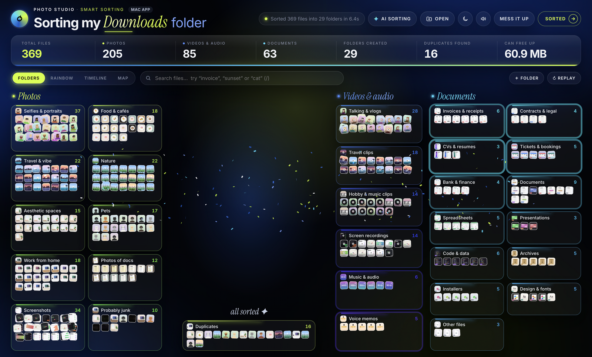

<p align="center">
  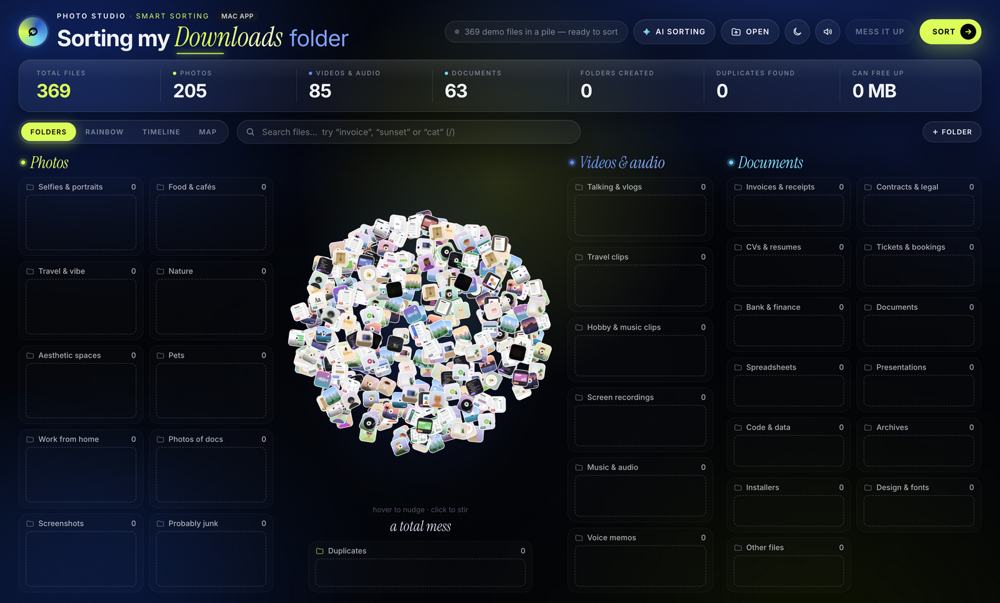
  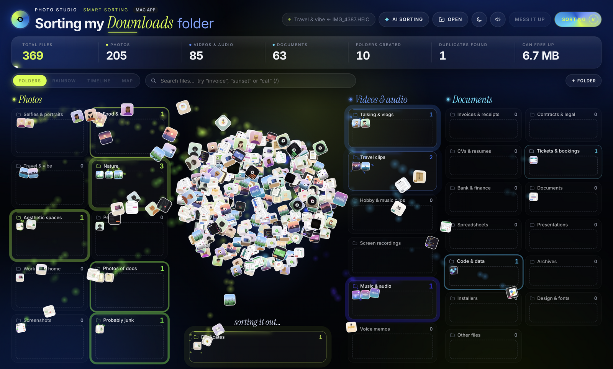
</p>

---

## Features

| | |
|---|---|
| **Every file type** | Photos, videos, audio and documents each get their own section. PDFs show their real first page, Office files show their text, audio shows its real waveform, and code/CSV render as mini previews. |
| **Reads documents** | Text is pulled out of PDFs, `.docx/.xlsx/.pptx`, `.txt/.md/.csv`, so documents land in **Invoices & receipts, Contracts & legal, CVs & resumes, Tickets & bookings, Bank & finance**. Everything else is sorted by type (Spreadsheets, Presentations, Code & data, Archives, Installers, Design & fonts…). |
| **On-device AI** ✦ | One click loads OpenAI's **CLIP** model (via transformers.js, ~150 MB, cached after the first time). Photos and videos are then sorted by what they *show*: selfies, food, travel, nature, pets, interiors, desk setups, photos of documents. |
| **Natural-language search** | Type "a cat", "sunset" or "invoice". Matching files fly out of their folders into the middle. AI matches photos by content; text search matches whole words in names *and inside documents*. |
| **Your own folders** | `＋ Folder` → "Wedding", "Receipts", "My dog". The AI fills it with matching photos, and documents mentioning the word go there too. |
| **Teach it** | Drag any tile into another folder. The file is remembered, and with AI on, visually similar files from the same mistake move along with it. |
| **Duplicates** | Exact copies (`IMG_1234 copy.HEIC`, `(1)`, `2`) and re-saved copies (perceptual hash + 24×24 pixel check). The sharpest original is kept. "Can free up" shows the space you'd recover. |
| **Probably junk** | Pocket shots (nearly black) and badly blurred photos (Laplacian-variance sharpness). |
| **Four views** | **Folders**, **Rainbow** (every file arranged by colour), **Timeline** (a histogram of files per month, from EXIF dates) and **Map** (photos placed by GPS). |
| **Moves the real files, with undo** | In Chrome/Edge/Arc or the Mac app, **Move files** puts everything into `Sorted/<Folder>/` inside the chosen folder. Nothing is overwritten or deleted, and **Undo moves** puts every file back. |
| **Mac app** | Menu-bar icon, native file moves, **Quick Look** previews (HEIC, RAW, Pages, Keynote, PSD…), read-only **Photos library** mode, and **auto-sort for new downloads** with a notification for each file. |
| **Sound design** | Generated live with the Web Audio API, no audio files. Each folder has its own note in a pentatonic scale, so every sort plays a unique melody, panned left or right by where the tile lands. Whooshes on take-off, a shimmer when sorting starts, a bell chord and pad when it finishes, plus small sounds for drag, drop, search and windows. All of it goes through a compressor and a synthetic reverb. |
| **Motion** | Frame-rate-independent springs. The pile slowly swirls like a galaxy and spirals in on load. Tiles fly in arcs with a little spin, leave colour trails, and land with a damped wobble and a burst of sparks. The pile inhales before a sort, clicks send ripples, and finishing rains confetti. Folders glow in their own colour as they fill. |
| **Design** | An editorial dark look built on three colours: **Midnight Black** `#030407`, **Electric Cobalt** `#1558C9` and **Acid Lime** `#D4FF24`. Big italic serif headlines, small tracked uppercase labels, lime pill buttons and a cobalt glow behind the pile. Photos glow lime, videos cobalt and documents electric cyan. A light theme uses the same palette. |
| **Polish** | WebGL rendering (smooth up to 10,000 files), drifting aurora background, cursor spotlight, glass cards with a sheen that follows the mouse, sliding view switcher, folder windows that zoom out of the card you clicked, dark (default), light and auto themes, Replay, keyboard shortcuts, a "Why is this here?" reason on every file. Respects *reduce motion*. |

<p align="center">
  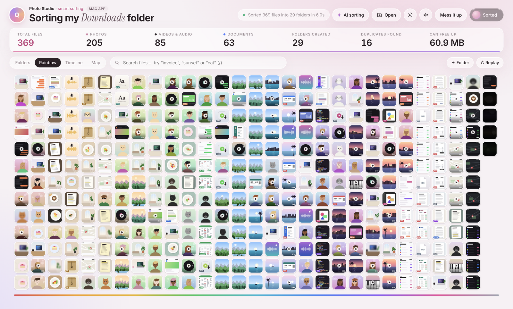
  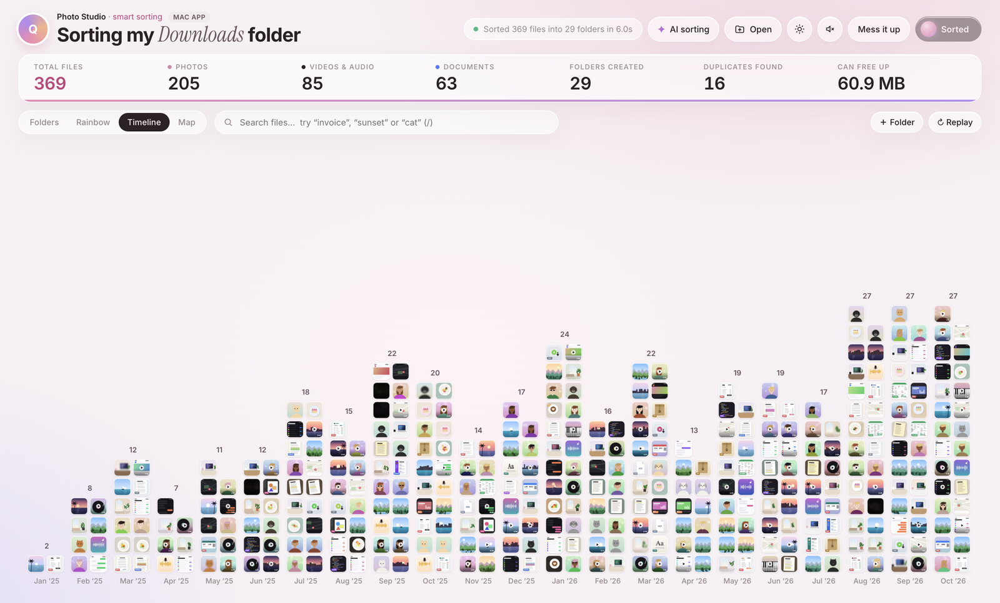
</p>
<p align="center">
  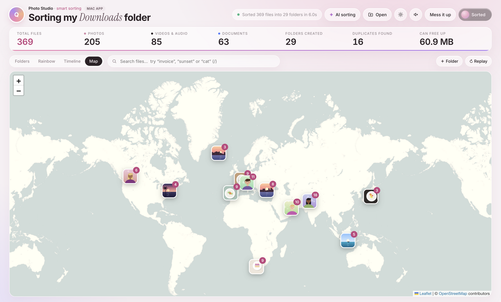
  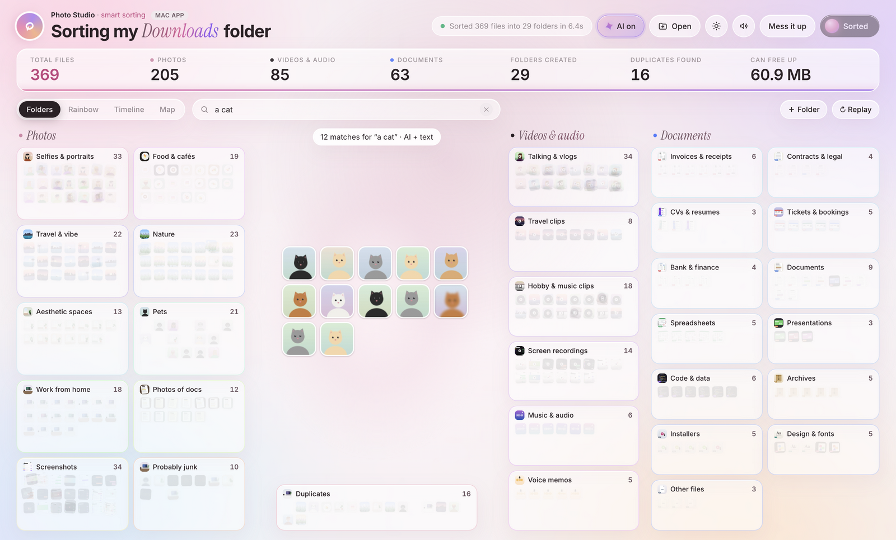
</p>
<p align="center">
  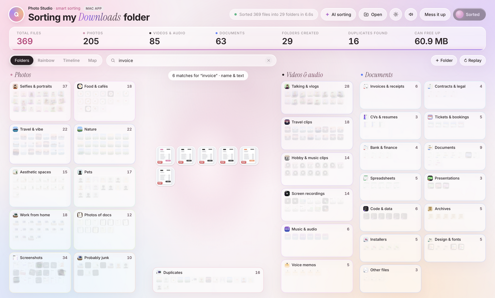
  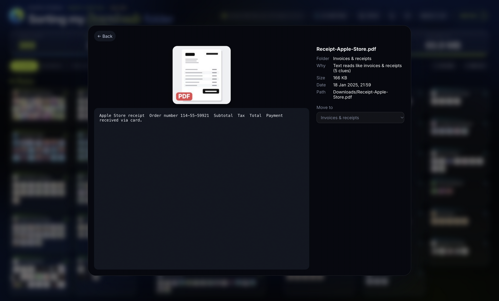
</p>
<p align="center">
  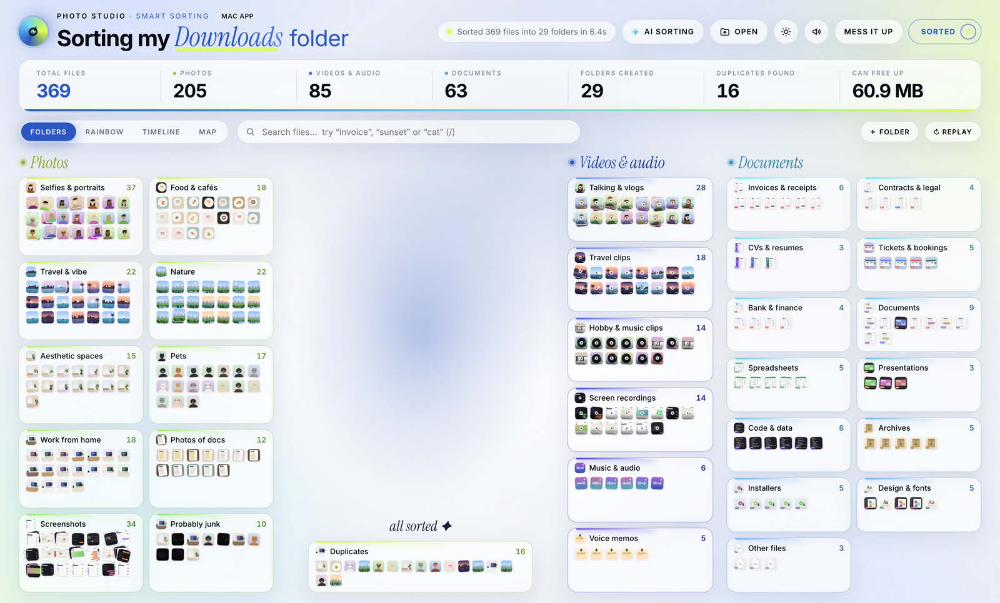
</p>

---

## Quick start

### 1. In the browser (no install)

Just open the **[live demo](https://aqkprogrammer.github.io/sort-any-folder-and-anything/)**. Or run it locally:

```bash
git clone https://github.com/aqkprogrammer/sort-any-folder-and-anything.git
cd sort-any-folder-and-anything
python3 scripts/serve.py        # → http://localhost:8765
```

Open **http://localhost:8765**. A demo "Downloads" folder of ~370 made-up files loads immediately. Press **Sort** (or <kbd>Space</kbd>).

To sort your own files: **Open → Choose a folder…**
- **Chrome / Edge / Arc** can move files (File System Access API) and undo.
- **Safari / Firefox** are read-only. Use **Export script** to get `sort-files.sh`, which prints what it would do; run it with `DRY_RUN=0` to actually move.

> The page must be served over `http://localhost` or HTTPS (not opened as a `file://`) because it uses ES modules and Web Workers.

### 2. As a Mac app

**Download:** grab the `.dmg` from the [latest release](https://github.com/aqkprogrammer/sort-any-folder-and-anything/releases/latest), open it and drag **Photo Sorter** into Applications. The app isn't signed or notarized, so the first time, right-click it → **Open** → **Open** (or run `xattr -dr com.apple.quarantine "/Applications/Photo Sorter.app"`).

**Or build it from source:**

```bash
npm install
npm start                 # launches the Electron app
npm run smoke             # headless self-test of scanning, moving, undo, Quick Look
npm run screenshots       # regenerates the images in docs/screenshots
npm run dist              # builds an unsigned .dmg into dist/
```

In the app, **Open** also offers **My Downloads** and **Photos library** (read-only; macOS asks for *Full Disk Access*). The menu-bar icon has **Auto-sort new downloads**: every finished download is analysed, moved to `Downloads/Sorted/<Folder>/`, and announced with a notification.

---

## Deployment

The web app is plain static files (`index.html` + `src/`), with no build step. Any static host works; it only needs **HTTPS** (for the File System Access API, Web Workers and WebAssembly).

| Where | How |
|---|---|
| **GitHub Pages** (live) | Already set up. [`.github/workflows/pages.yml`](.github/workflows/pages.yml) publishes `index.html` + `src/` on every push to `main` → **https://aqkprogrammer.github.io/sort-any-folder-and-anything/** |
| **Netlify** | Drag the repo folder onto [app.netlify.com/drop](https://app.netlify.com/drop), or connect the repo with publish directory `.` and no build command. |
| **Vercel** | `npx vercel --prod` in the repo root (framework preset: *Other*, no build command). |
| **Cloudflare Pages** | Connect the repo, build command empty, output directory `/`. |
| **Mac app** (released) | `CSC_IDENTITY_AUTO_DISCOVERY=false npm run dist` builds an unsigned `dist/Photo Sorter-<version>-arm64.dmg`. Attach it to a [GitHub Release](https://github.com/aqkprogrammer/sort-any-folder-and-anything/releases/latest) with `gh release create vX.Y.Z <dmg>`. The current build is on [v2.1.0](https://github.com/aqkprogrammer/sort-any-folder-and-anything/releases/latest). |

What the hosted version can and can't do:
- Everything runs in the visitor's browser. Their files never reach the server; the host only serves the code.
- The CLIP model (~150 MB) is downloaded from the Hugging Face CDN the first time AI is switched on, then cached by the browser.
- Moving real files on disk works in Chrome / Edge / Arc. Safari and Firefox are read-only and use **Export script**.
- Downloads auto-sort, Quick Look previews and the Photos library are Mac-app only.

## Tech stack

There is no framework and no build step: plain ES modules that the browser loads directly. Libraries come from CDNs at pinned versions.

| Layer | Technology | Used for |
|---|---|---|
| **UI** | HTML + modern CSS (custom properties, `color-mix`, grid, keyframes) | Layout, the Midnight / Cobalt / Lime palette as CSS tokens, dark / light / auto themes, aurora + grain atmosphere, glass panels, FLIP window animation |
| **Language** | Vanilla JavaScript (ES2022 modules) | All app logic, no bundler or transpiler |
| **Rendering** | [PixiJS 8](https://pixijs.com) (WebGL) | Thousands of animated tiles, texture atlases, particle effects |
| **AI** | [transformers.js 3](https://github.com/huggingface/transformers.js) + [CLIP ViT-B/32](https://huggingface.co/Xenova/clip-vit-base-patch32) (8-bit, WebAssembly) | Image and text embeddings for sorting by content and natural-language search |
| **Concurrency** | Web Workers | Runs CLIP off the main thread, so the animation never stutters |
| **Documents** | [pdf.js 4](https://mozilla.github.io/pdf.js/), a tiny ZIP reader on `DecompressionStream` | PDF first page + text; text from `.docx/.xlsx/.pptx` |
| **Photo metadata** | [exifr 7](https://github.com/MikeKovarik/exifr) | Capture date and GPS for Timeline and Map |
| **Audio** | Web Audio API | Real waveforms (`decodeAudioData`) and all generated sound effects (no audio files) |
| **Map** | [Leaflet 1.9](https://leafletjs.com) + [OpenStreetMap](https://www.openstreetmap.org/copyright) tiles | Photos placed by GPS |
| **Storage** | IndexedDB, localStorage | Cached AI embeddings, preferences, corrections and learned examples |
| **File access** | File System Access API, `webkitdirectory` fallback | Reading folders and moving files (with undo) in the browser |
| **Desktop** | [Electron 45](https://www.electronjs.org), Node `fs`, macOS `qlmanage` | Mac app: native moves, Quick Look thumbnails, tray icon, Downloads watcher |
| **Packaging** | electron-builder | `.dmg` for Apple Silicon |
| **Hosting / CI** | GitHub Pages + GitHub Actions | Live web version, deployed on every push |

---

## Architecture

The app has four layers. Each module only talks to the layer next to it, so the same core runs both in a browser tab and inside the Mac app.

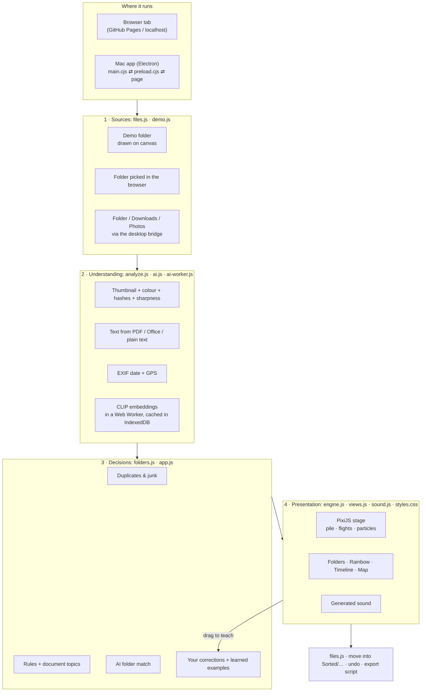

**Module responsibilities**

| Module | Responsibility |
|---|---|
| `app.js` | The conductor. Holds the state, loads a source, runs analysis in parallel (6 files at a time), classifies, builds the folder cards and choreographs the sort. Also handles views, search, drag-to-teach, windows, moves and keyboard shortcuts. |
| `engine.js` | Motion only. Knows nothing about files, only tiles with a target position. Springs, flight arcs, the swirling pile, particles, hit-testing and dragging. |
| `analyze.js` | Turns a file into numbers: a 176 px preview, colour statistics, a perceptual hash, a 24×24 fingerprint, a sharpness score, EXIF and extracted text. Also finds duplicates and junk. |
| `folders.js` | The folder catalogue and the rule-based classifier (file type → family → folder, document keyword topics, colour moods). |
| `ai.js` / `ai-worker.js` | Loads CLIP in a worker, embeds images and text, matches files to folders, powers search and learns from your corrections. |
| `views.js` | Layout maths for Rainbow and Timeline, and the Leaflet map. |
| `files.js` | Reading folders (browser, picker or desktop), moving files safely with undo, and the shell-script export. |
| `sound.js` | A tiny synthesiser: compressor + generated reverb, with pluck, bell, whoosh and pad instruments. |
| `electron/*` | The Mac shell: custom protocols, a path-checked IPC bridge, Quick Look, tray and Downloads watcher. |

### What happens when you press Sort

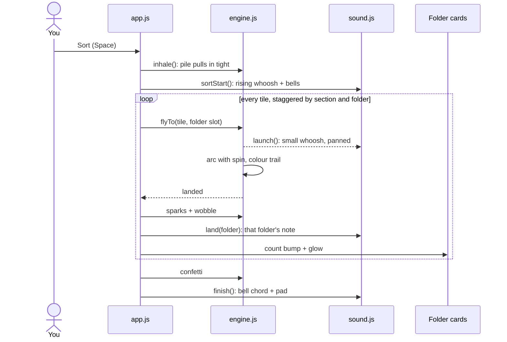

### How the AI works

1. Clicking **AI sorting** starts a Web Worker that downloads CLIP (~150 MB, once) and runs it with WebAssembly.
2. Every folder has a few text prompts, for example *Pets*: "a photo of a cat", "a photo of a dog", "a cute pet". CLIP turns them into vectors, and the folder's vector is their average.
3. Each photo, and one frame of each video, is turned into a vector too. These are cached in IndexedDB by name, size and date, so a second run is instant.
4. A file goes to the folder whose vector is closest (cosine similarity, softmax confidence).
5. **Search** embeds "a photo of *your words*" and flies the closest matches to the centre. **Your own folders** are just new prompts.
6. When you drag a file somewhere else, its vector is saved as an example. Files very similar to it (≥ 0.9) follow the example from then on.

## The analysis pipeline

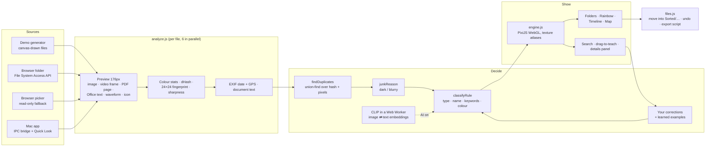

**Deciding where a file goes**, in order:

1. **Duplicate?** Same size + same base name (`IMG_1 copy.jpg`), or perceptual hash within 8 bits *and* a 24×24 pixel difference under 1.5 (re-saved copy) or under 3 (near-duplicate, never applied to screenshots). The sharpest file without a "copy" suffix is kept. → *Duplicates*
2. **Your correction** for this exact file. → that folder
3. **Junk?** Brightness < 6 % (pocket shot) or Laplacian variance < 60 (blurry). → *Probably junk*
4. **Rules that are always right:** "Screenshot…" / "Screen Recording…" names and phone-shaped PNGs → *Screenshots*; voice-memo names → *Voice memos*.
5. **AI (when on):** cosine similarity between the CLIP image embedding and each folder's averaged prompt embeddings ("a photo of a cat", "a cute pet"…). A drag-and-drop example with ≥ 90 % similarity overrides it.
6. **Documents:** keyword evidence in the extracted text (≥ 2 clues, e.g. *subtotal*, *VAT*, *total due* → Invoices), custom folder keywords, then the file type.
7. **No AI:** photos go by colour mood (greens, blue skies, golden, pinks, night, bright, black & white), videos by orientation.

Every file keeps the **reason** it was placed, shown in the details panel.

### Rendering and motion

All tiles are drawn by **PixiJS (WebGL)**. Thumbnails, with their rounded corners, white border and shadow baked in, are packed into 2048 px texture atlases with mipmaps, so thousands of tiles draw in a handful of draw calls.

The engine (`src/engine.js`) only does motion. `src/app.js` decides every target position.
- **The pile** is a set of springs that slowly swirl like a galaxy, push away from the cursor and ripple when clicked.
- **Flights** are quadratic-Bézier arcs with a little spin, a colour trail and a springy wobble on landing.
- **Particles** (sparks, rings, confetti) come from a pooled set of up to 1,400 sprites, so nothing is allocated during a sort.
- Physics is scaled by elapsed time, so it runs at the same speed at 60 Hz and 120 Hz. With *Reduce motion* on, trails, swirl and confetti are switched off.

### Sound

`src/sound.js` generates every sound with the Web Audio API, so there are no audio files. Everything goes through a compressor and a reverb built from generated noise. Each folder has its own note in a pentatonic scale, so any order of landings sounds like a melody, and each note is panned to where the tile lands.

### Privacy and safety

- No uploads, accounts or analytics. The only network requests are for the libraries (jsDelivr/cdnjs), the CLIP model (Hugging Face, once), and map tiles (OpenStreetMap) when you open the Map view.
- Files are only ever **moved**, never deleted or overwritten. Name clashes become `name (2).ext`. Moves go into a new `Sorted/` folder inside the folder you chose.
- The Mac app's main process only reads and moves inside folders you picked, re-checks every path, and treats the Photos library as read-only.

---

## Project structure

```
index.html            page layout
src/
  app.js              orchestration: loading, classification, sort choreography, views, search, drag-to-teach, moves
  engine.js           PixiJS renderer: texture atlases, pile physics, flight tweens, hit-testing, drag
  analyze.js          previews, colour stats, dHash, fingerprint, sharpness, EXIF, PDF/Office/text/audio readers, duplicates & junk
  folders.js          folder sets, file-type families, rule-based classifier, document keyword topics
  ai.js               CLIP client: embedding cache (IndexedDB), folder matching, search, learning
  ai-worker.js        transformers.js + CLIP ViT-B/32 (8-bit) in a Web Worker
  views.js            Rainbow and Timeline layouts, Leaflet map with thumbnail clustering
  files.js            folder sources (browser / picker / desktop), moves with undo, shell-script export
  demo.js · draw.js   the procedurally drawn demo Downloads folder (no image assets)
  sound.js            Web Audio instruments: plucks, bells, whooshes, pads, reverb
  util.js · styles.css
electron/
  main.cjs            app:// + localfile:// protocols (with HTTP Range), IPC, Quick Look, tray, Downloads watcher, smoke test
  preload.cjs         the window.desktop bridge
  tour.cjs            scripted screenshot capture
scripts/serve.py      no-cache static server for the web version
docs/screenshots/     images used in this README (npm run screenshots)
.github/workflows/
  pages.yml           deploys the web app to GitHub Pages
```

## Keyboard

| Key | Action |
|---|---|
| <kbd>Space</kbd> | Sort / mess it up |
| <kbd>/</kbd> | Search |
| <kbd>1</kbd>–<kbd>4</kbd> | Folders · Rainbow · Timeline · Map |
| <kbd>R</kbd> | Mess it up |
| <kbd>Esc</kbd> | Close / clear search |

## Limitations

- The first AI run downloads ~150 MB. On CPU (WebAssembly) it reads roughly 4–5 images per second; results are cached per file in IndexedDB.
- CLIP is strong on real photos but only "good" on the demo's cartoon drawings (89 % correct with screenshots handled by rules).
- Grouping people by face is not implemented.
- Chrome can't decode HEIC/RAW, so those get a placeholder tile in the browser. The Mac app renders them with Quick Look.
- Up to 10,000 files per folder. Undo history lasts until you close the page or app.
- The Mac build is unsigned. `npm run dist` produces a `.dmg` that macOS will ask you to approve on first launch.

## Built with

[PixiJS](https://pixijs.com) · [transformers.js](https://github.com/huggingface/transformers.js) + [CLIP](https://huggingface.co/Xenova/clip-vit-base-patch32) · [pdf.js](https://mozilla.github.io/pdf.js/) · [exifr](https://github.com/MikeKovarik/exifr) · [Leaflet](https://leafletjs.com) + [OpenStreetMap](https://www.openstreetmap.org/copyright) · [Electron](https://www.electronjs.org) · Inter & Instrument Serif
